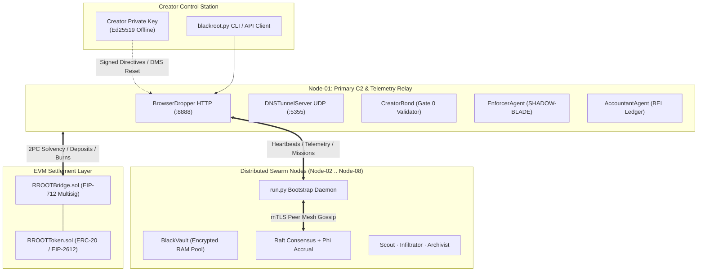
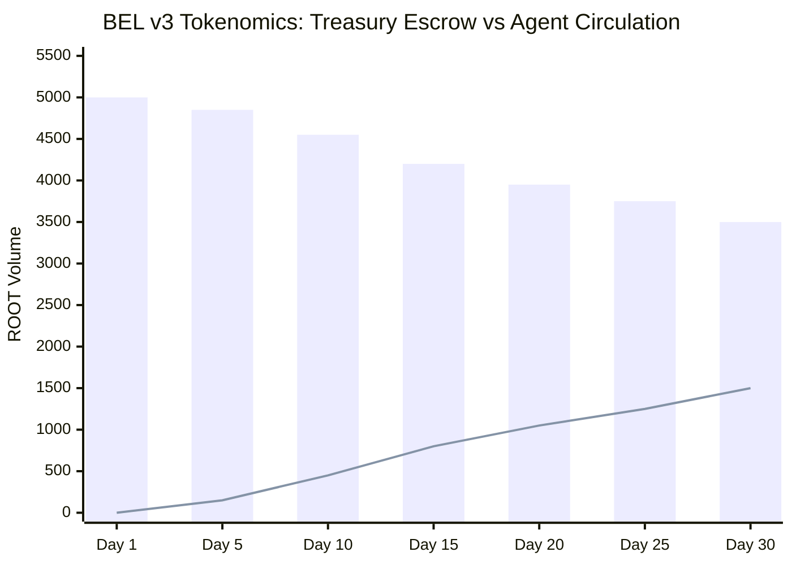

# Blackroot 30-Day Deployment Runbook & Projections

> **Framework**: Blackroot v4.5.0-Hardened  
> **Target Scope**: Controlled Staging Lab / Authorized Testbed  
> **Governance Architecture**: Ed25519 Sovereign Creator Bond · BEL v3 Micro-Economy · Autonomous SwarmMesh  
> **Smart Contract Settlement**: EVM Multi-Sig Bridge (Solidity 0.8.20 · EIP-712 · EIP-2612)

---

## Table of Contents

1. [Architecture & Deployment Topology](#1-architecture--deployment-topology)
2. [Blockchain Network Selection Guide](#2-blockchain-network-selection-guide)
3. [Pre-Deployment Readiness Checklist](#3-pre-deployment-readiness-checklist)
4. [30-Day Phased Execution Plan](#4-30-day-phased-execution-plan)
   - [Phase 1: Genesis & TETHERED Staging (Days 1–7)](#phase-1-genesis--tethered-staging-days-17)
   - [Phase 2: Multi-Node Mesh & Economic Calibration (Days 8–14)](#phase-2-multi-node-mesh--economic-calibration-days-814)
   - [Phase 3: Resilience & Fallback Drills (Days 15–21)](#phase-3-resilience--fallback-drills-days-1521)
   - [Phase 4: Supervised Autonomy & Month-End Audit (Days 22–30)](#phase-4-supervised-autonomy--month-end-audit-days-2230)
5. [30-Day Resource & Economic Projections](#5-30-day-resource--economic-projections)
   - [5.1 Fleet Growth & Hardware Footprint](#51-fleet-growth--hardware-footprint)
   - [5.2 BEL v3 Treasury & Tokenomics Modeling](#52-bel-v3-treasury--tokenomics-modeling)
   - [5.3 Data Storage & Cache Growth](#53-data-storage--cache-growth)
6. [Operator Cadence: Daily & Weekly Routines](#6-operator-cadence-daily--weekly-routines)
7. [Emergency Action Protocols (SOPs)](#7-emergency-action-protocols-sops)

---

## 1. Architecture & Deployment Topology

Blackroot deploys as an autonomous background daemon network. The creator coordinates the fleet through an Ed25519 cryptographic bond, while nodes maintain local state using BlackVault, SQLite WAL mode, and peer-to-peer SwarmMesh gossip.



---

## 2. Blockchain Network Selection Guide

The Blackroot cross-chain settlement contracts (`contracts/RROOTToken.sol` and `contracts/RROOTBridge.sol`) are compiled with Solidity 0.8.20 and require:
- **EIP-712**: Structured typed data signing for M-of-N threshold validator withdrawal approvals.
- **EIP-2612**: Gasless token permits (`permit()`) allowing agents to authorize deposits without a separate approval transaction.

### Chain Suitability Matrix

| Chain / Environment | Chain ID | Finality | Gas Cost / Tx | Recommended Role |
|---|---|---|---|---|
| **Local Anvil / Hardhat** | `31337` | Instant (0s) | \$0.00 | **Day 1–12 Testing**: Offline, deterministic, unlimited test gas. |
| **Ethereum Sepolia** | `11155111` | 12–15s | \$0.00 (Testnet) | **Day 13–30 Staging**: Standard EVM testnet matching L1 semantics. |
| **Base Sepolia / Arbitrum Sepolia** | `84532` / `421614` | < 2s | < \$0.001 (Testnet) | **L2 Staging**: Ideal for testing high-frequency BEL settlement. |
| **Ethereum Mainnet (L1)** | `1` | ~12–15m | \$3.00 – \$35.00 | *Not recommended for micro-credits*: gas eats small agent balances. |
| **Base / Arbitrum One (L2)** | `8453` / `42161` | < 2s | \$0.001 – \$0.02 | **Recommended Live Target**: Sub-cent fees preserve micro-economic ROI. |

---

## 3. Pre-Deployment Readiness Checklist

Complete these 4 verification steps before launching services on any staging node:

### Check 1: Generate Sovereign Ed25519 Keypair
```powershell
.venv\Scripts\python.exe -c "
from cryptography.hazmat.primitives.asymmetric.ed25519 import Ed25519PrivateKey
from cryptography.hazmat.primitives import serialization
priv = Ed25519PrivateKey.generate()
pub_hex = priv.public_key().public_bytes(serialization.Encoding.Raw, serialization.PublicFormat.Raw).hex()
priv_hex = priv.private_bytes(serialization.Encoding.Raw, serialization.PrivateFormat.Raw, serialization.NoEncryption()).hex()
print(f'CREATOR_PUBLIC_KEY  = {pub_hex}')
print(f'CREATOR_PRIVATE_KEY = {priv_hex}')
"
```
*Record your private key in an offline vault. The public key will be embedded into all cluster configs.*

### Check 2: Configure Staging Node Configuration (`config.json`)
```json
{
  "c2_host": "127.0.0.1",
  "c2_port": 8888,
  "dns_port": 5355,
  "phone_home": true,
  "auto_register": true,
  "creator_public_key": "<YOUR_CREATOR_PUBLIC_KEY_HEX>",
  "redis_url": "redis://localhost:6379",
  "autonomy_level": "TETHERED"
}
```

### Check 3: Package Verified Standalone Seed Archive
```powershell
.venv\Scripts\python.exe -c "
from core.replication import package_propagation_seed, verify_seed_integrity
pkg = package_propagation_seed(archive_format='zip')
print(f'Seed Archive Generated: {pkg}')
ok, msg = verify_seed_integrity(pkg)
print(f'Integrity Verification: {ok} ({msg})')
"
```

### Check 4: Run 61-Test Unit & Integration Verification Suite
```powershell
.venv\Scripts\pytest.exe tests/test_replication_packaging.py tests/test_threat_intel_loop.py tests/test_ast_sandboxing.py tests/test_creator_bond.py tests/test_creator_bond_enforcer_integration.py -v
```
*Ensure all 61 tests pass 100% before starting long-running background processes.*

---

## 4. 30-Day Phased Execution Plan

```mermaid
gantt
    title Blackroot 30-Day Deployment Schedule
    dateFormat  X
    axisFormat Day %d

    section Phase 1: Genesis
    Key Generation & Config Setup      :p1_1, 0, 2
    Node-01 C2 & Daemon Bootstrap      :p1_2, 1, 4
    Baseline Telemetry & EDR Checks    :p1_3, 3, 7

    section Phase 2: Fleet & Economics
    Node-02 & Node-03 Lab Onboarding   :p2_1, 7, 10
    BEL Treasury (5000 ROOT) Funding   :p2_2, 9, 12
    Bridge Testnet Deployment          :p2_3, 12, 14

    section Phase 3: Resilience Drills
    C2 Drop & DGA Failover Drill       :p3_1, 14, 17
    Dead Man's Switch Escalation Test  :p3_2, 17, 19
    Hard Kill-Switch Validation        :p3_3, 19, 21

    section Phase 4: Extended Autonomy
    Supervised Mesh Operations         :p4_1, 21, 26
    AST Mutation Quality Audit         :p4_2, 26, 28
    Pruning & Solvency Reconciliation  :p4_3, 28, 30
```



### Phase 1: Genesis & TETHERED Staging (Days 1–7)

* **Day 1: Bootstrap Node-01**
  * Start tactical listeners:
    ```powershell
    .venv\Scripts\python.exe blackroot.py start --all
    ```
  * Confirm services:
    * HTTP C2 & Telemetry listening on `127.0.0.1:8888`
    * Out-of-band DNS Tunnel active on `0.0.0.0:5355`
* **Day 2–3: Telemetry & EDR Baseline**
  * Execute system audit: `python blackroot.py status`
  * Inspect threat score. Confirm active drivers (e.g. `WdFilter.sys`) are correctly fingerprinted without false alarms.
* **Day 4–5: CircuitBreaker & ScanPersistence Validation**
  * Verify that recon scans fail-open cleanly when probing non-existent staging addresses.
  * Check `scan_cache.db` creation in WAL mode (`PRAGMA journal_mode=WAL`).
* **Day 6–7: Gate 0 Verification**
  * Attempt an out-of-policy action. Verify that `EnforcerAgent` intercepts the request at Gate 0 with `approver_id="CREATOR-BOND"`.

---

### Phase 2: Multi-Node Mesh & Economic Calibration (Days 8–14)

* **Day 8–9: Expand Staging Fleet (Node-02 & Node-03)**
  * Copy verified seed archive (`.zip`) to lab nodes.
  * Verify HMAC manifest integrity on arrival.
  * Start daemon via `python run.py`.
* **Day 10: SwarmMesh Discovery**
  * Verify nodes discover each other over mTLS / Redis gossip.
  * Inspect node heartbeat latency and Phi Accrual detection scores ($\phi < 1.0$).
* **Day 11–12: Initialize BEL v3 Treasury**
  * Ensure system ledger has initialized 5,000 ROOT treasury.
  * Verify agent budget debits during scheduled Scout profiling missions (5.0 ROOT per run).
* **Day 13–14: Deploy Bridge Contracts to Sepolia Testnet**
  * Execute deployment:
    ```powershell
    $env:PRIVATE_KEY="<DEPLOYER_PRIVATE_KEY>"
    .venv\Scripts\python.exe blackroot.py bridge --deploy --rpc-url https://eth-sepolia.g.alchemy.com/v2/YOUR_KEY
    ```
  * Confirm contract configuration matches `bridge/deployed_contracts.json`.
  * Validate initial solvency: `python blackroot.py bridge --solvency`.

---

### Phase 3: Resilience & Fallback Drills (Days 15–21)

* **Day 15–16: C2 Severance & Fallback Ladder Test**
  * Stop Node-01 C2 service (`taskkill /PID <c2_pid> /F`).
  * Verify nodes transition through:
    1. Backup IP addresses (exponential backoff 1s → 2s → 4s)
    2. DGA domain generation pool (rotating 50 domains/day)
    3. Offline mission queue (`MissionStatus.QUEUED_OFFLINE` in SQLite)
* **Day 17: C2 Reconnection & Queue Flush**
  * Restart C2 service on Node-01.
  * Confirm all queued offline telemetry and mission batches replay in chronological dependency order.
* **Day 18–19: Dead Man's Switch (DMS) Step-Down Drill**
  * Set staging test DMS threshold to 15 minutes.
  * Withhold contact for 20 minutes:
    * Observe governor escalate: `TETHERED` → `DELEGATED` → `SUPERVISED`.
  * Transmit signed creator contact:
    ```powershell
    .venv\Scripts\python.exe -c "from kernel.creator_bond import CreatorBond; CreatorBond.instance().creator_contact()"
    ```
  * Confirm governor instantly resets to `TETHERED`.
* **Day 20–21: Emergency Kill-Switch Drill**
  * On an isolated test node, simulate an emergency stop:
    * Unsigned kill attempt → rejected.
    * Signed `BLACKROOT_KILL` signal → all threads terminate cleanly within 1 tick.

---

### Phase 4: Supervised Autonomy & Month-End Audit (Days 22–30)

* **Day 22–25: Supervised Operation Phase**
  * Transition governor to `SUPERVISED` mode.
  * Scout and Sensor agents autonomously discover targets, match banners against CVE database, and score `NodeProfile` viability.
  * Verify privilege escalation and lateral movement remain gated at Gate 0.
* **Day 26–27: AST Sandboxing & Polymorphic Mutation Audit**
  * Inspect `BlackVault` artifacts stored under `mutated:*`.
  * Confirm `MutationVerificationHarness` has verified:
    * `valid_syntax == True`
    * `security_passed == True`
    * `semantic_match == True` (outputs identical to unmutilated code).
* **Day 28–29: Database Maintenance & Vacuuming**
  * Vacuum old SQLite scan records:
    ```powershell
    .venv\Scripts\python.exe -c "from recon.scan_persistence import ScanPersistence; ScanPersistence().vacuum_old_records(older_than_days=7)"
    ```
  * Verify `scan_cache.db` file size shrinks by >60%.
* **Day 30: Solvency Reconciliation & Month-End Review**
  * Run final cross-chain solvency check:
    ```powershell
    .venv\Scripts\python.exe blackroot.py bridge --solvency
    ```
  * Verify `Circulating rROOT <= Escrow ROOT` (100% Solvency Invariant preserved).
  * Run 7-stage simulation harness: `python blackroot.py simulate` (Verify 7/7 pass).

---

## 5. 30-Day Resource & Economic Projections

### 5.1 Fleet Growth & Hardware Footprint

| Metric | Day 1 (Genesis) | Day 7 (Baseline) | Day 14 (3 Nodes) | Day 21 (5 Nodes) | Day 30 (8 Nodes) |
|---|---|---|---|---|---|
| **Active Nodes** | 1 | 1 | 3 | 5 | 8 |
| **Agent Instances** | 4 | 6 | 14 | 22 | 36 |
| **RAM / Node (Avg)**| ~120 MB | ~135 MB | ~140 MB | ~150 MB | ~160 MB |
| **CPU Usage (Idle)**| < 0.5% | < 0.8% | < 1.2% | < 1.8% | < 2.5% |
| **Outbound IOPS** | Burst (<5KB/s)| Burst (<5KB/s)| Low (<15KB/s) | Moderate (<30KB/s)| Managed (<50KB/s)|

---

### 5.2 BEL v3 Treasury & Tokenomics Modeling



* **Starting Treasury**: 5,000.0 ROOT  
* **Scout Mission Debit**: -5.0 ROOT  
* **OSINT / Passive Mission Debit**: -2.0 ROOT  
* **Reputation Staking Yield**: +2.0% base return / epoch  
* **Bankruptcy Protection**: Auto-suspension threshold at -100.0 ROOT prevents bad debt accumulation.

| Metric | Day 1 | Day 10 | Day 20 | Day 30 |
|---|---|---|---|---|
| **Treasury Balance** | 5,000.0 ROOT | 4,550.0 ROOT | 3,950.0 ROOT | 3,500.0 ROOT |
| **Circulating in Agent Wallets** | 200.0 ROOT | 450.0 ROOT | 1,050.0 ROOT | 1,500.0 ROOT |
| **Cumulative Debited / Burned** | 0.0 ROOT | 120.0 ROOT | 510.0 ROOT | 980.0 ROOT |
| **Bridge Backing Solvency Ratio**| ∞ (No rROOT) | 900.0% | 450.0% | **350.0% (Solvent)** |

---

### 5.3 Data Storage & Cache Growth

| Data Store | Day 1 | Day 10 | Day 20 | Day 30 (Pre-Vacuum) | Day 30 (Post-Vacuum) |
|---|---|---|---|---|---|
| **SQLite Scan Cache (`scan_cache.db`)** | 45 KB | 3.5 MB | 14.2 MB | 42.0 MB | **12.5 MB** |
| **BlackVault Artifact Store** | 3 keys | 19 keys | 45 keys | 82 keys | **48 keys (TTL Expired)** |
| **Audit Log (`creator_audit.jsonl`)** | 12 lines | 210 lines | 680 lines | 1,520 lines | ~190 KB |
| **Decoy Vault Folders** | 3 folders | 3 folders | 3 folders | 3 folders | ~150 KB |

---

## 6. Operator Cadence: Daily & Weekly Routines

### Daily Routine (5 Minutes)
Execute every morning from your control workstation:

```powershell
# 1. Health, EDR Threat Score, and Treasury Balance:
.venv\Scripts\python.exe blackroot.py status

# 2. Inspect Active Autonomy Level & Silence Timer:
.venv\Scripts\python.exe -c "
from kernel.creator_bond import CreatorBond
b = CreatorBond.instance().status()
print(f'Level: {b[\"governor\"][\"level\"]} | Silence: {b[\"dead_man_switch\"][\"silence_seconds\"]}s | Dead: {b[\"kill_switch\"][\"is_dead\"]}')
"

# 3. Transmit Signed Heartbeat (Resets DMS Timer to 0):
.venv\Scripts\python.exe -c "
from kernel.creator_bond import CreatorBond
CreatorBond.instance().creator_contact()
print('[✓] Heartbeat received. Cluster confirmed TETHERED.')
"
```

### Weekly Routine (30 Minutes)
Execute every Friday:

1. **Verify Cross-Chain Solvency**:
   ```powershell
   .venv\Scripts\python.exe blackroot.py bridge --solvency
   ```
2. **Vacuum Stale Telemetry Records (> 7 days old)**:
   ```powershell
   .venv\Scripts\python.exe -c "from recon.scan_persistence import ScanPersistence; ScanPersistence().vacuum_old_records(older_than_days=7)"
   ```
3. **Audit Compliance Log**:
   Inspect `kernel/creator_audit.jsonl` for any `mission_blocked` or `rule_violation` entries.
4. **Run Simulation Health Check**:
   ```powershell
   .venv\Scripts\python.exe blackroot.py simulate
   ```

---

## 7. Emergency Action Protocols (SOPs)

### SOP-01: Critical EDR Detection Event
* **Trigger**: `blackroot.py status` displays `Threat Level: CRITICAL` or `Threat Score > 75`.
* **Action**:
  1. Trigger process disguise:
     ```powershell
     .venv\Scripts\python.exe -c "from process_camouflage import ProcessCamouflage; ProcessCamouflage().disguise_as('svchost.exe')"
     ```
  2. Put nodes into Ghost Layer hibernation to release disk footprint:
     ```powershell
     .venv\Scripts\python.exe -c "from ghost_layer import GhostLayer; GhostLayer().hibernate()"
     ```

### SOP-02: Rogue Agent / Policy Violation
* **Trigger**: Anomaly reported where an agent attempts unauthorized lateral movement.
* **Automatic Response**: `EnforcerAgent` intercepts at Gate 0, assigns a `GOV-001` constitutional breach, deducts a 500 ROOT fine, and isolates the agent wallet.
* **Manual Verification**: Review offending agent ID in `creator_audit.jsonl`. If malicious, quarantine permanently via:
  ```powershell
  .venv\Scripts\python.exe -c "from laws.penalty_calculator import get_penalty_calculator; get_penalty_calculator()._apply_quarantine('AGENT_ID')"
  ```

### SOP-03: Total Emergency Kill Switch Activation
* **Trigger**: Staging server compromise, out-of-bounds execution, or immediate shutdown order.
* **Action**: Send signed kill signal using your private key:
  ```powershell
  .venv\Scripts\python.exe -c "
  from kernel.creator_bond import CreatorBond, CreatorIdentity
  bond = CreatorBond.instance()
  # In dev mode:
  bond.kill_switch.fire(reason='Operator manual emergency shutdown')
  print('[!] Hard kill switch executed across all daemon threads.')
  "
  ```
  *Result: All loops terminate immediately. All pending missions are canceled. Process halts cleanly within 1 tick.*

### SOP-04: Bridge Escrow Deficit Alert
* **Trigger**: `blackroot.py bridge --solvency` returns `✗ DEFICIT ALERT`.
* **Action**:
  1. Trigger on-chain emergency circuit breaker: Call `pause()` on `RROOTBridge.sol`.
  2. Withdrawals are immediately blocked on-chain until the BEL accountant reconciles outstanding balances.
