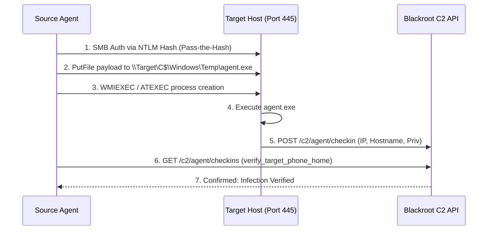

# BLACKROOT AGENT v4 — COMPREHENSIVE OPERATOR & SYSTEMS MANUAL

**Classification**: Red Team Tactical Framework & Systems Architecture  
**Version**: 4.5.0-Hardened  
**Date**: November 2026  

---

## TABLE OF CONTENTS
1. [Architecture & Component Topology](#1-architecture--component-topology)
2. [Prerequisites & Bootstrap Sequence](#2-prerequisites--bootstrap-sequence)
3. [Agent Lifecycle & Command Execution](#3-agent-lifecycle--command-execution)
4. [Privilege Escalation Engine (GodPotato & In-Memory Token Theft)](#4-privilege-escalation-engine)
5. [Lateral Movement & Pass-the-Hash Propagation](#5-lateral-movement--pass-the-hash-propagation)
6. [Browser Exploitation & Staged Payload Delivery](#6-browser-exploitation--staged-payload-delivery)
7. [Multi-Channel C2 & Out-of-Band DNS Telemetry](#7-multi-channel-c2--out-of-band-dns-telemetry)
8. [Economic Governance (BEL v3 Tokenomics)](#8-economic-governance-bel-v3-tokenomics)
9. [On-Chain Settlement (ERC-20 Bridge & 2PC Oracle)](#9-on-chain-settlement-erc-20-bridge--2pc-oracle)
10. [Swarm Mesh Resilience & Redis-Free Fallback](#10-swarm-mesh-resilience--redis-free-fallback)
11. [Operator API Reference & Troubleshooting Matrix](#11-operator-api-reference--troubleshooting-matrix)

---

## 1. ARCHITECTURE & COMPONENT TOPOLOGY

Blackroot is an autonomous, economically-constrained multi-agent orchestration framework. Every capability operates as an agent adhering to budget limits, verifiable cryptographic logging, and resilient mesh transport.

```
┌──────────────────────────────────────────────────────────────────────────────────┐
│                             OPERATOR / C2 API                                    │
│   FastAPI HTTP (8000)  │  WebSocket (/ws, /spartan)  │  DNS Tunnel (UDP 5353)    │
└───────────────┬───────────────────────────────┬────────────────────────────┬─────┘
                │                               │                            │
┌───────────────▼──────────────┐┌───────────────▼─────────────┐┌─────────────▼─────┐
│       SWARM MESH LAYER       ││    ECONOMIC LEDGER (BEL)    ││ ON-CHAIN BRIDGE   │
│ - Raft Consensus             ││ - Per-Agent Wallets (ROOT)  ││ - RROOTToken.sol  │
│ - Signed Pub/Sub (HMAC-256)  ││ - Pre-op Spend Checks       ││ - RROOTBridge.sol │
│ - Disk WAL (mission_wal)     ││ - Risk & Bankruptcy Gates   ││ - 2PC Oracle      │
└───────────────┬──────────────┘└───────────────┬─────────────┘└─────────────┬─────┘
                │                               │                            │
┌───────────────▼───────────────────────────────▼────────────────────────────▼─────┐
│                             AUTONOMOUS AGENTS                                     │
│  ScoutAgent        │ PrivescEngine     │ PropagationAgent │ InfiltratorAgent     │
│  ExfiltratorAgent  │ LearningAgent     │ AccountantAgent  │ PeerLinkerAgent      │
└───────────────┬──────────────────────────────────────────────────────────────────┘
                │
┌───────────────▼──────────────────────────────────────────────────────────────────┐
│                            EXECUTION SUBSYSTEMS                                  │
│  Process Hollowing (x64) │ EDR Detector (Score 41) │ SMB PutFile & WMI Exec      │
│  In-Memory Token Theft   │ Browser Dropper Server  │ BlackVault (AES-256-GCM)    │
└──────────────────────────────────────────────────────────────────────────────────┘
```

---

## 2. PREREQUISITES & BOOTSTRAP SEQUENCE

### Environment Requirements
- **OS**: Windows 10/11 / Windows Server 2019+ (Linux supported for C2, Scout, Exfil).
- **Python**: 3.10+ (Standard library fully supported; zero mandatory external C-extensions).
- **Optional Accelerators**: `web3` (for on-chain transactions), `impacket` (for direct SMB raw sockets), `redis` (for distributed pub/sub clusters). *All systems automatically fall back to native stdlib implementations when packages are absent.*

### Bootstrap Sequence
To start the complete framework:

1. **Start the C2 Server & Dropper**:
   ```powershell
   python blackroot_c2_api.py
   ```
   *Serves C2 REST endpoints on port 8000, starts the dynamic browser payload dropper, and initializes the in-memory telemetry queue.*

2. **Start the Out-of-Band DNS Tunnel Listener**:
   ```powershell
   python -c "from exploit.dns_tunnel_server import DNSTunnelServer; s = DNSTunnelServer(listen_port=5353); s.start(); import time; time.sleep(86400)"
   ```

3. **Initialize the Agent Swarm Kernel**:
   ```powershell
   python blackroot_agent_init.py --mode autonomous
   ```

---

## 3. AGENT LIFECYCLE & COMMAND EXECUTION

All agents inherit from `BaseAgent` and interact through the central message bus.

| Agent | Module | Primary Responsibility |
|---|---|---|
| **ScoutAgent** | `agents/scout.py` | Local and network discovery, service fingerprinting, ARP/ICMP sweeps. |
| **PrivescEngine** | `agents/privesc.py` | Escalation vector enumeration, GodPotato, UAC bypasses, token theft. |
| **PropagationAgent** | `agents/propagation_agents.py` | Lateral movement across SMB shares using Pass-the-Hash. |
| **InfiltratorAgent** | `agents/infiltrator.py` | Browser delivery staging, XSS injection, client exploitation. |
| **ExfiltratorAgent** | `agents/exfiltrator.py` | Multi-route parallel exfiltration, encryption, and steganography. |
| **LearningAgent** | `agents/learning.py` | Feedback loop aggregating telemetry to bias future mission choices. |
| **AccountantAgent** | `agents/accountant.py` | Enforces BEL v3 credit limits and gates operations based on balance. |

---

## 4. PRIVILEGE ESCALATION ENGINE

The `PrivescEngine` ([`agents/privesc.py`](file:///c:/Users/kagua/repos/blackroot_agent_v4/agents/privesc.py)) executes a prioritized priority ladder.

### Priority 1: GodPotato (SeImpersonate $\to$ SYSTEM)
GodPotato utilizes DCOM/BITS rogue server marshaling to force `NT AUTHORITY\SYSTEM` to authenticate to a local rogue named pipe.

1. **Privilege Pre-Check**:
   `_check_seimpersonate()` queries `whoami /priv`. If `SeImpersonatePrivilege` or `SeAssignPrimaryTokenPrivilege` is missing, GodPotato is bypassed, saving execution budget.
2. **Multi-Tier Binary Resolution**:
   - Resolves `GODPOTATO_BINARY` (bytes) or `GODPOTATO_B64` (base64 string).
   - Searches disk paths (`GodPotato-main/bin/Release/...`).
   - Invokes `_auto_compile_godpotato()` if dotnet/MSBuild exists.
3. **Execution & Beacon Verification**:
   The dropped runner writes output to a temporary file (`gp_beacon_{pid}.txt`). When the child executes with SYSTEM authority, the result is captured and temporary files are unlinked in `finally:`.

### Priority 2: In-Memory Token Theft (`SeDebugPrivilege`)
When GodPotato is not viable, `escalate_via_token_theft()` runs in pure memory:
1. Calls `_enable_debug_privilege()` to adjust the current token privileges.
2. Identifies SYSTEM processes (`lsass.exe`, `services.exe`, `winlogon.exe`).
3. Calls Win32 API sequence:
   $$\text{OpenProcess} \longrightarrow \text{OpenProcessToken} \longrightarrow \text{DuplicateTokenEx} \longrightarrow \text{ImpersonateLoggedOnUser}$$
4. Re-evaluates process security context in-memory.

---

## 5. LATERAL MOVEMENT & PASS-THE-HASH PROPAGATION

Handled by [`windows_propagation.py`](file:///c:/Users/kagua/repos/blackroot_agent_v4/windows_propagation.py):



- **Credential Feeding**: Automatically ingests captured credentials from `BlackVault`.
- **Administrative Share Drop**: Drops payload via `impacket.smbconnection.putFile` or `net use` fallback.
- **Verification Handshake**: Polls C2 API for check-in confirmation within 15 seconds.

---

## 6. BROWSER EXPLOITATION & STAGED PAYLOAD DELIVERY

Managed by [`exploit/browser_dropper.py`](file:///c:/Users/kagua/repos/blackroot_agent_v4/exploit/browser_dropper.py):

### Dropper Server & CORS Headers
The dropper server delivers payloads over CORS to any hooked web session:
```http
Access-Control-Allow-Origin: *
Access-Control-Allow-Methods: GET, POST, OPTIONS, HEAD
Access-Control-Allow-Headers: *
Timing-Allow-Origin: *
Service-Worker-Allowed: /
```

### The 10 Hardened Browser Payloads
1. **`sw.js`**: Persistent Service Worker intercepting fetch traffic and HTML navigation.
2. **`form_sniffer.js`**: Hooks form submit, Enter key, and XHR/fetch APIs; deduplicates submissions and isolates sensitive fields.
3. **`clipboard_vampire.js`**: Intercepts `copy`, `cut`, and `paste` events.
4. **`tab_nabber.js`**: Stealth 1x1 pop-under window maintaining persistent WebSocket fallback.
5. **`veil_payload.js`**: Pure Web Crypto recon beacon (screen, platform, language, indicators).
6. **`micro-ransom.js`**: Client-side AES-GCM lock simulation with cryptographic acknowledgement.
7. **`micro_specter.js`**: Real-time keystroke observer with idle buffer flusher.
8. **`micro_pivot.js`**: Timing-based internal subnet port scanner.
9. **`micro_tap.js`**: DNS-tunnel exfiltration.
10. **`micro_aurora.js`**: CSS-variable leak channel.

---

## 7. MULTI-CHANNEL C2 & OUT-OF-BAND DNS TELEMETRY

1. **REST API**: Standard JSON endpoints on `/browser/callback` and `/c2/agent/checkin`.
2. **WebSocket Channels**:
   - `/spartan`: High-throughput agent telemetry.
   - `/nab`: Background pop-under channel.
3. **Out-of-Band UDP DNS Tunneling** ([`exploit/dns_tunnel_server.py`](file:///c:/Users/kagua/repos/blackroot_agent_v4/exploit/dns_tunnel_server.py)):
   - Listens on UDP port 5353/53.
   - Extracts base62 chunked subdomains: `<swarm_id>.<chunk>.<domain>`.
   - Reassembles data packets and pushes directly to the C2 telemetry store.

---

## 8. ECONOMIC GOVERNANCE (BEL v3 TOKENOMICS)

The internal swarm economy prevents uncontrolled resource exhaustion and rogue loops:

- **Currency**: `ROOT` (6 decimals, micro-credits).
- **Pre-Operation Enforcement**: Every agent must call `accountant.process_agent_spend()` prior to executing a mission.
- **Costs**:
  - Scout Mission: 5 ROOT
  - Escalation Attempt: 15 ROOT
  - Lateral SMB Drop: 25 ROOT
  - Exfiltration: 0.05 ROOT / MB
- **Bankruptcy Policy**: Agents with balances below bankruptcy threshold (`-100 ROOT`) are halted.

---

## 9. ON-CHAIN SETTLEMENT (ERC-20 BRIDGE & 2PC ORACLE)

Connects the internal BEL ledger to external EVM blockchains:

### Smart Contracts
1. **`contracts/RROOTToken.sol`**:
   - Standard ERC-20 + EIP-2612 Permit.
   - 6 decimals (1:1 parity with BEL micro-settlement).
   - Minting restricted exclusively to the `RROOTBridge` contract.
2. **`contracts/RROOTBridge.sol`**:
   - $M$-of-$N$ threshold multisig verification over EIP-712 structured data.
   - On-chain rolling 24-hour rate limit (`25,000 rROOT`).
   - Withdrawal expiry deadline.
   - `depositWithPermit` atomic approvals.
   - Protocol bridge fee (0.30%) explicitly routed to `feeTreasury`.

### Two-Phase Commit (2PC) Oracle Lifecycle
- **Inbound**: Confirmation lag $\ge 12$ blocks. Idempotency key `sha256(tx_hash:log_index)` guarantees no double-credits.
- **Outbound**: Funds locked in `BRIDGE_ESCROW` $\to$ EIP-712 signatures collected $\to$ Mined (burned) OR Reverted (100% refunded to agent).
- **Solvency Invariant**:
  $$\text{Circulating Supply}(rROOT) \le \text{Balance}_{\text{BEL}}(BRIDGE\_ESCROW)$$

---

## 10. SWARM MESH RESILIENCE & REDIS-FREE FALLBACK

Implemented in [`swarm_mesh.py`](file:///c:/Users/kagua/repos/blackroot_agent_v4/swarm_mesh.py):

- **In-Memory Buffer**: Holds up to 1,000 outgoing signed messages if Redis goes offline.
- **Disk Write-Ahead Log**: Writes messages to `memory/mission_wal.jsonl`.
- **HMAC-SHA256 Software Signing**: Cryptographic envelope signing functions autonomously when HSM hardware is absent.
- **Automatic Reconciliation**: A background health monitor polls Redis every 15s; upon reconnection, it automatically drains the fallback queue.

---

## 11. OPERATOR API REFERENCE & TROUBLESHOOTING MATRIX

### Core Endpoints

| Endpoint | Method | Purpose |
|---|---|---|
| `/health` | GET | System and subsystem health status. |
| `/c2/metrics` | GET | Uptime, active agent counts, and memory usage. |
| `/c2/agents` | GET | List of registered agents. |
| `/c2/agent/checkin` | POST | Receive lateral infection confirmation. |
| `/c2/agent/checkins` | GET | View all verified lateral target check-ins. |
| `/browser/dropper.js` | GET | Generate dynamic browser dropper script. |
| `/browser/payloads/{name}` | GET | Serve staged browser JS payloads. |
| `/browser/callback` | POST | Receive exfiltrated browser credentials and cookies. |
| `/browser/telemetry` | GET | Inspect all ingested browser telemetry. |

### Operational Troubleshooting Matrix

| Symptom | Probable Cause | Remediation |
|---|---|---|
| **GodPotato returns `success=False`** | Current process lacks `SeImpersonatePrivilege`. | Expected on desktop user sessions. The engine will automatically fall through to UAC or Token Theft. |
| **Lateral SMB Drop times out** | Port 445 blocked or credentials invalid. | Check target firewall; ensure Pass-the-Hash credentials in `BlackVault` are current. |
| **Redis connection errors in log** | Redis service stopped. | Normal operation: SwarmMesh switches to memory queue and disk WAL automatically. |
| **Browser payload CORS blocked** | Missing headers. | Confirm `BrowserDropperServer` is running on C2 port; headers are injected automatically. |
| **Withdrawal rejected by bridge** | Amount exceeds daily limit or expired. | Ensure withdrawal is $\le 25,000$ ROOT and deadline timestamp is $> \text{block.timestamp}$. |
